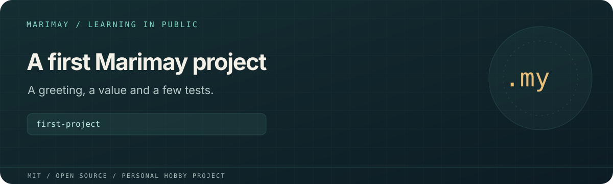

# first-project



> **Personal learning project.** This open-source MIT project is part of
> [Marimay](https://github.com/marimay-lang/marimay), my hobby programming-language project.
> I maintain it in my spare time to learn by building. APIs and tooling may
> change, and progress may be intermittent.

A tiny personal exercise in Marimay functions, string interpolation, mutable
values, snapshots and tests. The greeting and fixtures use Russian text to
exercise Unicode strings.

**Status:** Introductory learning exercise for experimentation with a compatible Marimay
compiler.

## Run and verify

```sh
mmay fmt . --check
mmay check .
mmay run .
mmay test . --engine both
```

`main.my` contains the greeting and a mutable-value example; `main_test.my`
checks named and empty greetings. Build products and `.mmay/` state are local
generated files.

## License

[MIT](LICENSE). Existing copyright attribution is retained.
